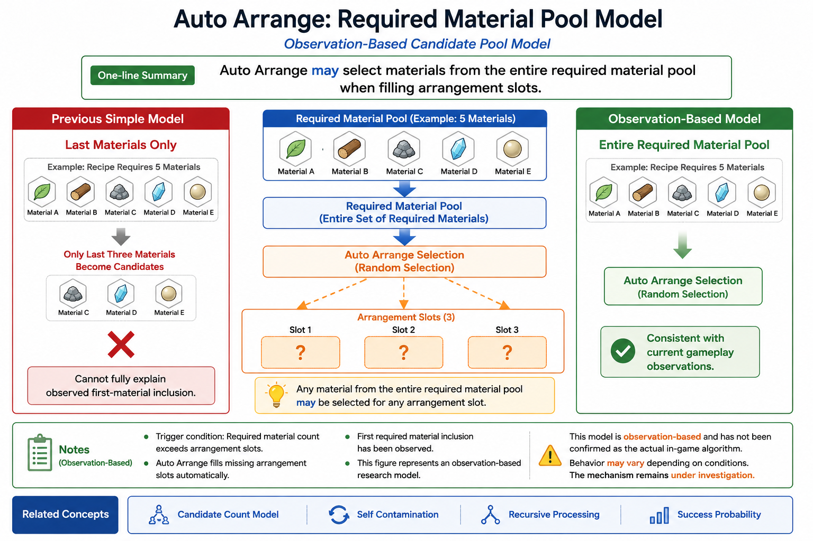
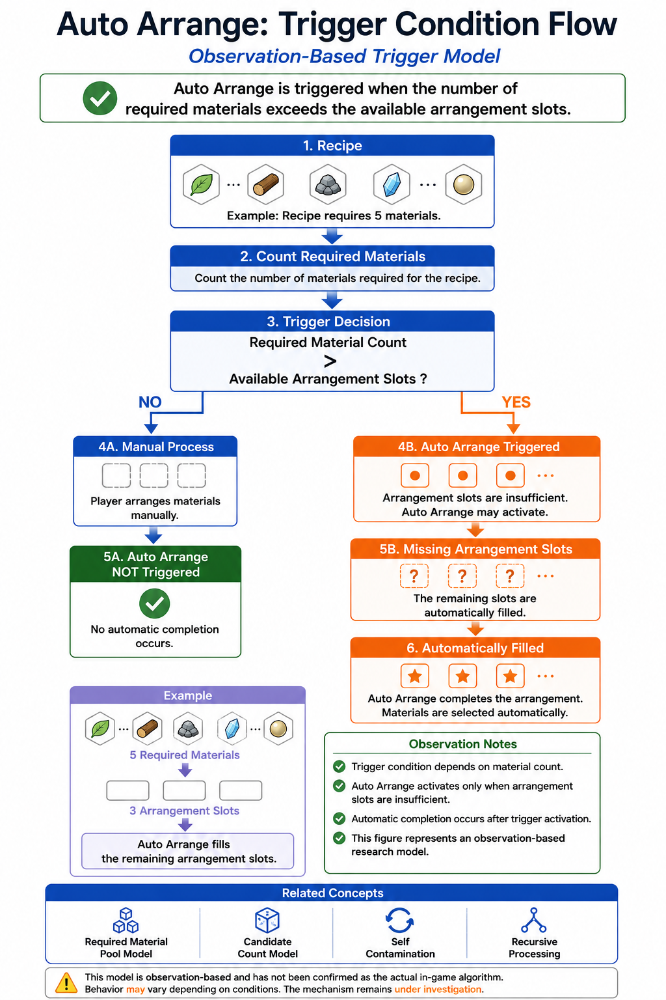
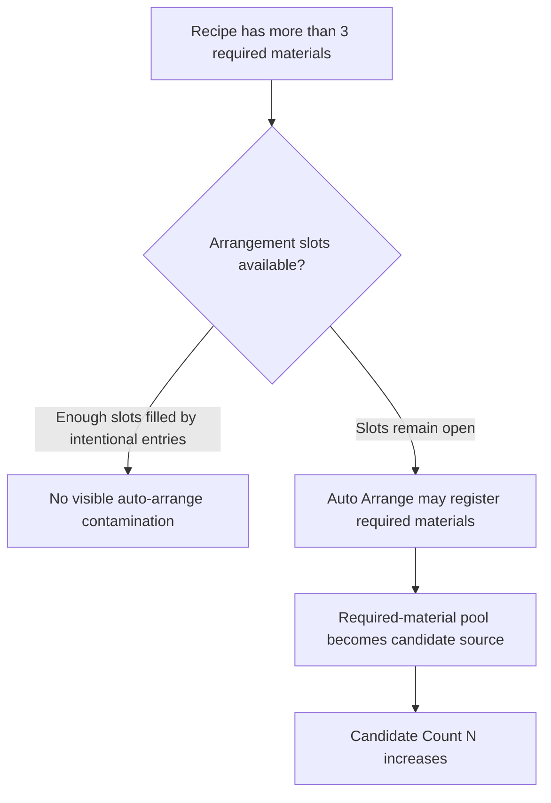
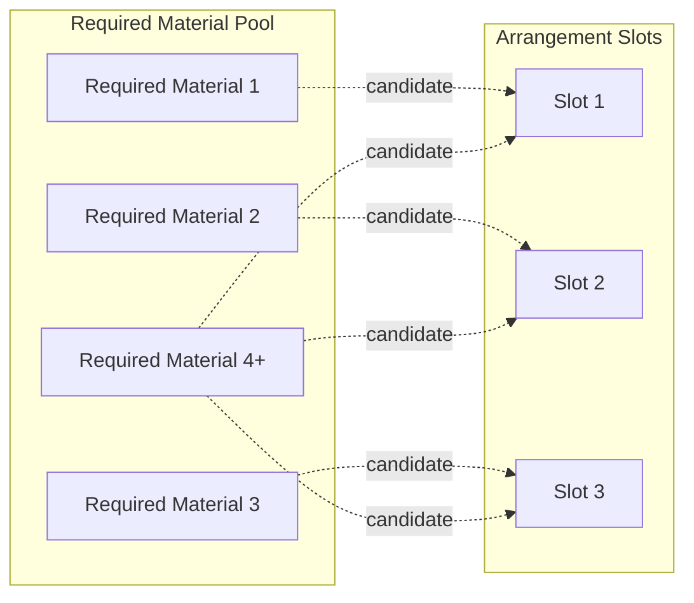
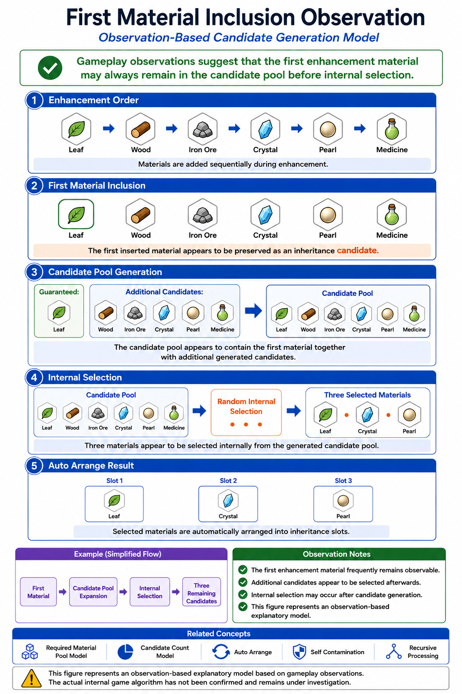
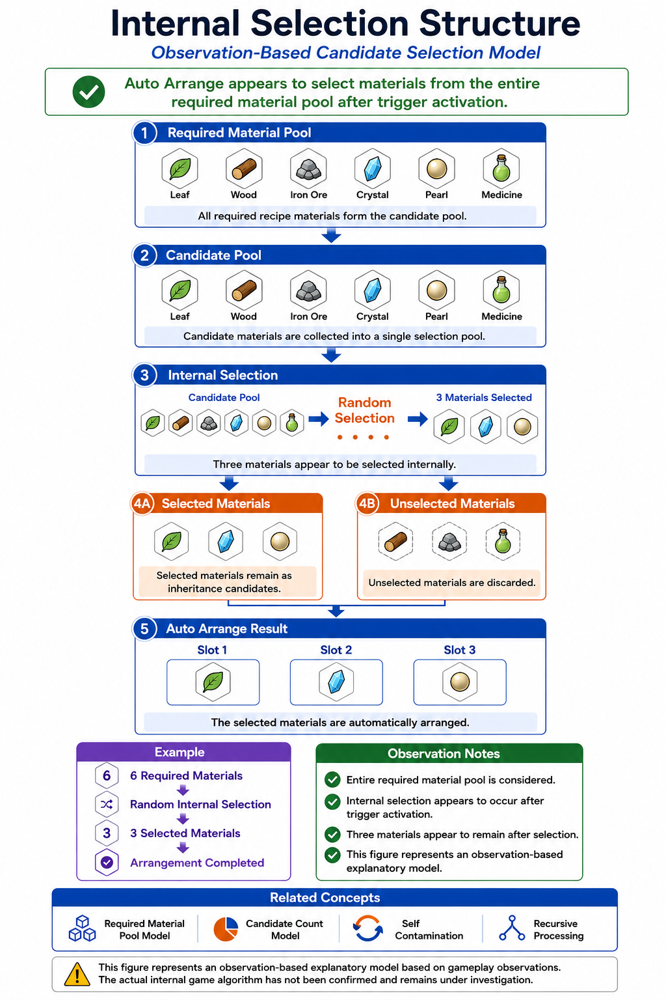
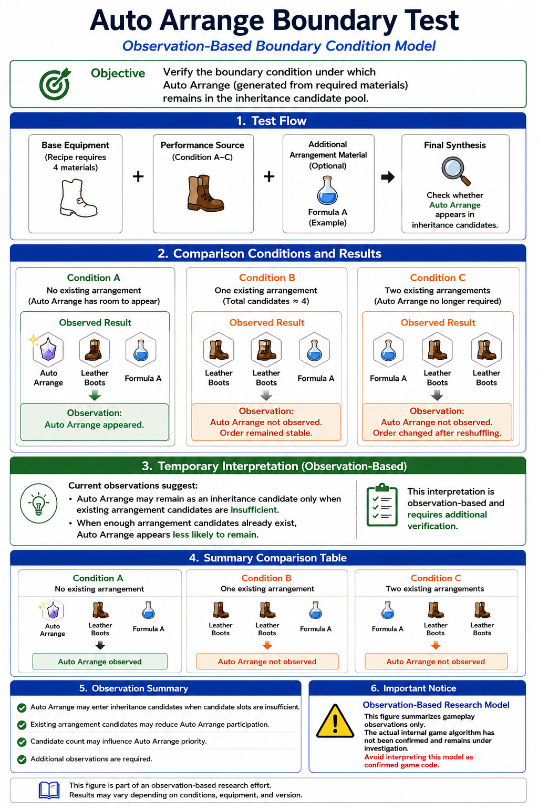

# Auto Arrange

## Overview

Auto Arrange is an observation-based research topic describing how required recipe materials may become inheritance candidates in some recipes with more than three required materials.

This article is a high-level English entry point. It does not claim to reveal the internal implementation. It summarizes one conceptual model that helps explain repeated gameplay observations in Rune Factory 4 Special and Rune Factory 5.

---

## Why It Matters

Auto Arrange matters because it can increase the effective candidate pool even when the player did not intend to add extra inheritance candidates.

In this repository, the core question is not simply:

> Did the desired inheritance succeed?

The more useful question is:

> How many candidates were created before the final three arrangement slots were selected?

Auto Arrange is therefore treated as one interface of the broader Candidate Count Model. When additional required materials become candidates, the candidate count `N` may increase, and the chance of keeping the desired three entries may decrease.

---

## Representative Figures



*Conceptual model: required recipe materials may act as a candidate pool when Auto Arrange is triggered.*



*Earlier simplified trigger flow. The current conditional refill model below also accounts for existing candidates and equipment category.*

---

## Mermaid Source Concept

The following diagrams preserve an earlier conceptual account. The arrows summarize possible relationships; internal processing order and the selection rule are unresolved.





---

## Core Mechanism

The working model is:

```text
Recipe required materials
        ↓
Arrangement slot pressure
        ↓
Auto Arrange candidate registration
        ↓
Candidate Count N increases
        ↓
Final three arrangement entries become less predictable
```

A simplified interpretation is:

- Normal arrangement capacity is limited to three slots.
- Recipes with more than three required materials may create pressure on that structure.
- Required materials may be registered as candidates even when they were not the player's intended inheritance targets.
- Once these materials become candidates, they can compete with desired entries.

This does not mean Auto Arrange always appears visibly in the final result. It means Auto Arrange may affect the candidate-generation stage under certain conditions.

---

### Conditional refill model

With no added Arrangement entries, the public guide uses baseline refill counts of zero for recipes with up to three required materials, one for four, and two for five. The following example model applies when exactly one same-category item is added, its internal Arrangement is referenced, and no other additional candidates or special inheritance are involved.

Before refill, count the referenced internal entries. In this model, shoes and accessories also contribute one body candidate; other ordinary equipment does not get that extra body candidate. The estimated refill is the smaller of the baseline count and the unused space below three entries (zero if there are already three or more candidates). For example, with five required materials and two referenced internal entries, the model gives zero refill for shoes or accessories and one for other ordinary equipment.

Refill concerns additional candidates. Candidate loss concerns the selection of entries for the three final slots. A shoe or accessory body and three internal entries can yield four candidates before refill, so a candidate can be lost even with zero refill. The model summarizes the public observations and does not establish an internal algorithm or independent validation of every combination on both titles. See [the current Auto Arrange guide](https://j13343sh.github.io/Rune-Factory-Inheritance-Research/guides/auto-arrange-control.html) for the tables and their scope.

## Observations

The current article reflects several observation-oriented points from the Japanese research archive.

### Required-material selection may not be simple tail selection

Some observations suggest that Auto Arrange is not necessarily limited to the last required material in a recipe. First-material contamination has also been observed.



*Observation figure: required material selection may involve a broader required-material pool rather than a simple fixed tail rule.*

### Internal selection model



*Earlier conceptual figure. It illustrates recipe materials as a possible source of candidates. The specific material chosen and the internal selection operation remain unresolved.*

### RF4SP / RF5 boundary test



*Boundary observations help separate stable three-slot behavior from candidate expansion behavior.*

---

## Practical Implications

For practical equipment building, Auto Arrange suggests a simple rule:

> Do not only count the materials you intended to inherit. Also consider recipe-required materials that may become candidates.

This is especially important when building high-difficulty equipment where success depends on preserving a specific set of three entries.

Practical precautions include:

- prefer recipes with fewer required materials when possible;
- avoid unnecessary candidate expansion;
- separate intermediate crafting steps when candidate pressure becomes too high;
- consider the [Cushion Method](https://j13343sh.github.io/Rune-Factory-Inheritance-Research/guides/cushion-method.html) when an unwanted internal reference is the problem. Under the documented first-reference conditions, place an appraised same-category item with an empty internal Arrangement first. Shoes and accessories can still contribute that item as a body candidate; confirm refill and final candidates separately;
- verify final inheritance results rather than assuming the visible recipe explains all candidates.

---

## Relationship to Candidate Count Model

Auto Arrange is not treated as a separate theory. It is treated as one candidate-generation route.

```text
Auto Arrange
        ↓
Additional candidate generation
        ↓
Candidate Count N increases
        ↓
Combination space expands
        ↓
Success probability may decrease
```

Auto Arrange is adjacent to Equipment-Body Candidateization and Internal Arrangement Reference in the article network. These behaviors inform the conditional counts above. Their internal transitions and broader effect on `N` remain unresolved.

---

## Detailed Research PDF

This article provides an English overview only.

The earlier Japanese PDF preserves the observations and interpretations from that stage of the research.

**Note:** PDF documents are currently available in Japanese only.

- [Auto Arrange Detailed Analysis](../pdf/03_オートアレンジ詳細.pdf)

---

## Related Articles

### Research Root

- [Candidate Count Model](Candidate-Count-Model.md)

### Related Mechanics

- [Equipment-Body Candidateization](Self-Contamination.md)
- [Internal Arrangement Reference](Recursive-Processing.md)
- [Success Probability](Success-Probability.md)
- [Light Ore Inheritance](Messhilite-Inheritance.md)

---

## Notes

This article describes an observation-based model. It should not be read as a definitive implementation claim.

---

## Navigation

- [Back to Articles](README.md)
- [Back to ROADMAP](../ROADMAP.md)
- [Back to Repository README](../README.md)
