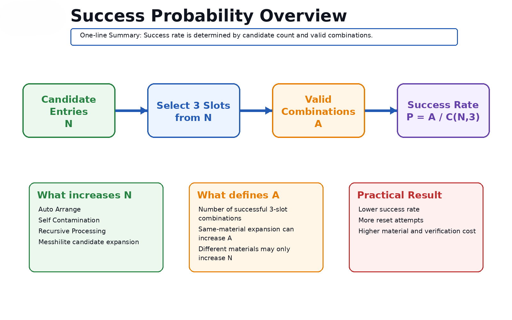
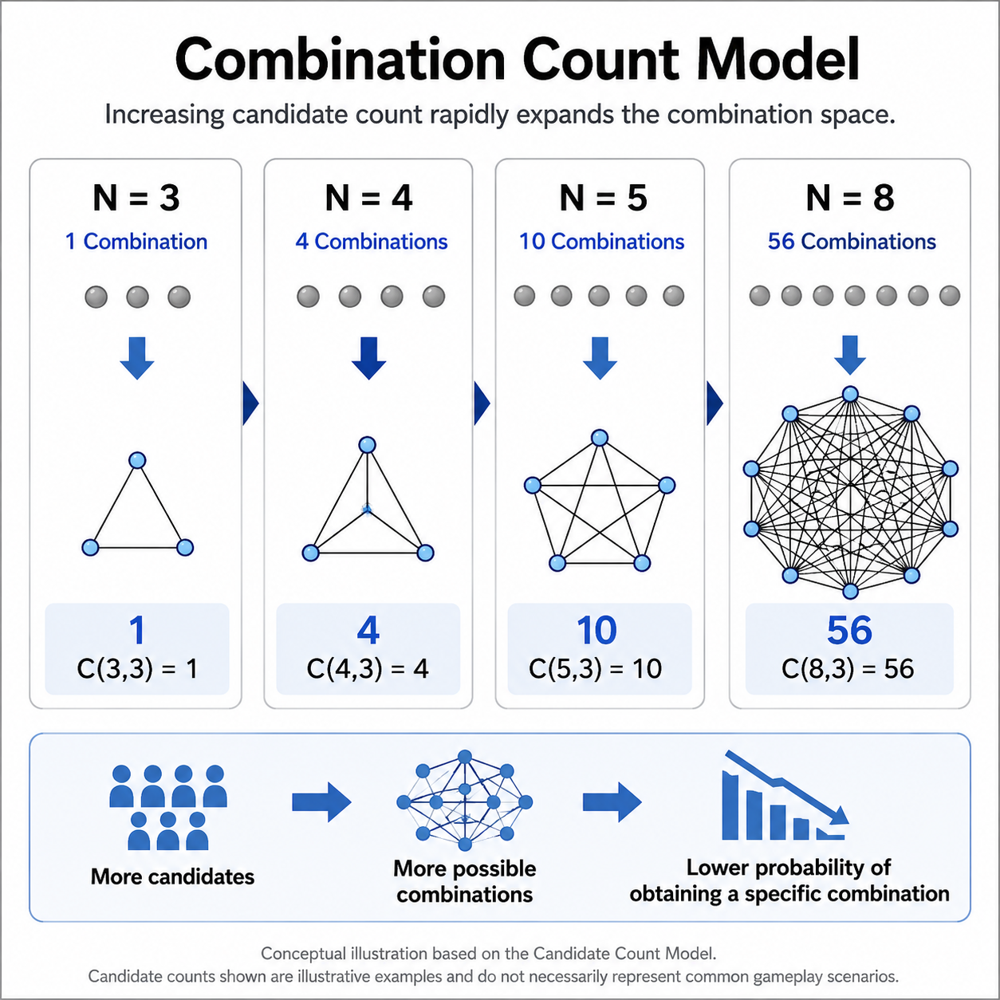
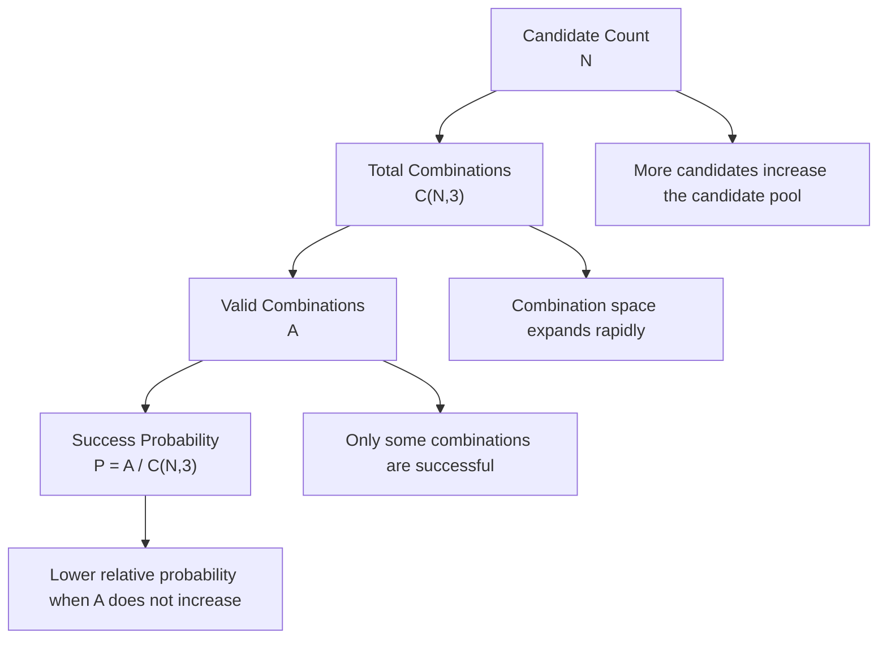
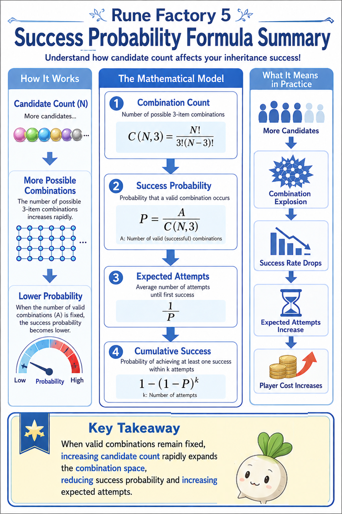
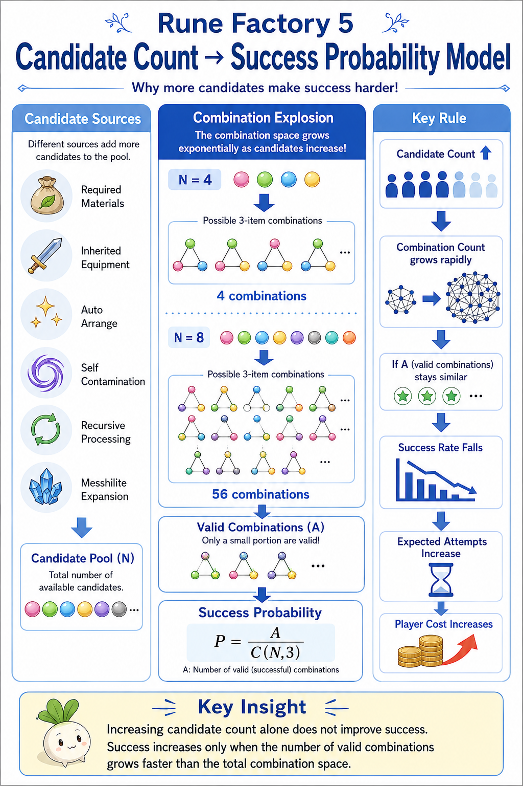
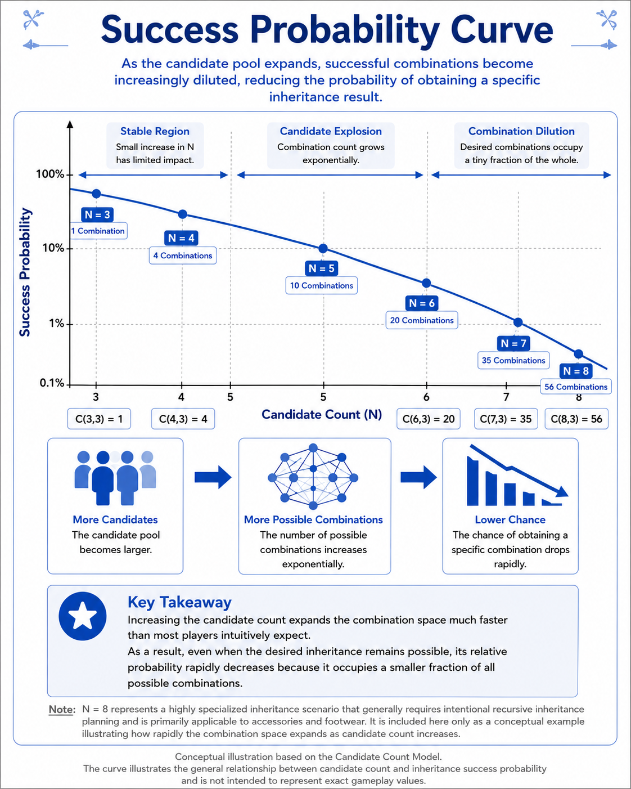
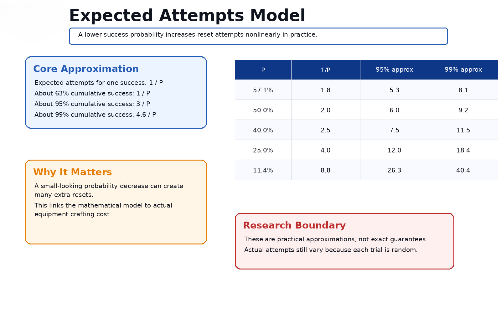

# Success Probability

## Overview

Success Probability is an observation-based research topic describing how inheritance success can be interpreted through candidate count and combination space.

This article summarizes the mathematical interface of the Candidate Count Model.

The goal is not to claim the exact internal implementation. The goal is to provide a practical model for comparing defined candidate pools and selection assumptions.

---

## Why It Matters

Many inheritance outcomes feel random when viewed one attempt at a time.

If the candidate set is defined, three distinct entries are selected without replacement, and all unordered three-entry combinations are equally likely, their counts can model the probability of an order-independent target.

The basic idea is:

```text
Candidate Count N
        ↓
Total three-slot combinations C(N,3)
        ↓
Successful combinations A
        ↓
Success Probability P = A / C(N,3)
```

This lets the repository explain multiple phenomena with the same framework:

- Auto Arrange increases candidate count.
- Equipment-Body Candidateization is observed, but its effect on the effective candidate count must be established for the tested setup.
- Internal Arrangement Reference is observed separately; a recursive candidate expansion is not confirmed.
- Apply the combination formula only to a specified, supported candidate set and selection model.
- Messhilite experiments provide validation observations.

---

## Representative Figures



*Overview: candidate count affects the space of possible three-slot outcomes.*



*Conceptual model: success probability depends on how many valid combinations remain inside the expanded candidate space.*

---

## Mermaid Source Concept



---

## Core Formula

The simplified model used in this repository is:

```text
P ≈ A / C(N,3)
```

Where:

- `N` = candidate count;
- `C(N,3)` = number of possible three-slot combinations;
- `A` = number of combinations that satisfy the desired inheritance condition;
- `P` = approximate success probability.

For unequal selection probabilities, success is the sum of the probabilities of the successful outcomes. For an order-dependent goal, an unordered combination count alone is insufficient. Agreement with trials does not establish the game’s implementation. The formula does not apply universally to RF4SP or RF5. See the [public RF5 reference calculator and its limits](https://j13343sh.github.io/Rune-Factory-Inheritance-Research/guides/candidate-count-calculator.html).



*Formula summary for the candidate-count success model.*

---

## Combination Space



*Combination count expands quickly as candidate count increases.*

The important practical lesson is that adding candidates can be harmful even when those candidates do not look important individually.

Under the equal-likelihood assumptions, increasing the total number of combinations while holding `A` fixed reduces their successful share. If the successful combinations or selection probabilities change, candidate count alone cannot determine the direction.

---

## Probability Curve



*Illustrative curve for the stated reference model. Its trend depends on the relative growth of successful and total combinations.*

---

## Expected Attempts



*Expected attempts and cumulative success become important when practical crafting requires repeated resets or repeated material preparation.*

In practical equipment building, success probability is not only a theoretical number. It affects:

- expected reset count;
- material consumption;
- time cost;
- whether an inheritance route is practical.

---

## Practical Implications

The Success Probability model suggests several practical rules:

- reducing candidate count is often more valuable than adding more materials;
- extra materials are dangerous if they increase `N` without increasing `A`;
- intermediate crafting can sometimes reduce final-stage candidate pressure;
- low-probability inheritance should be planned as a route, not attempted blindly.

---

## Relationship to Messhilite Validation

Messhilite experiments are treated as one validation interface for this model.

In the current RF5 validation dataset, each stack condition contains 1,000 trials:

| Condition | Trials | Successes | Observed Rate | Reference Model |
|---|---:|---:|---:|---:|
| 3-stack | 1,000 | 250 | 25.0% | 25.0% |
| 4-stack | 1,000 | 387 | 38.7% | 40.0% |
| 5-stack | 1,000 | 519 | 51.9% | 50.0% |
| 6-stack | 1,000 | 571 | 57.1% | 57.1% |

These observations are consistent with the candidate-count / combination-space interpretation, but they do not prove the internal implementation.

---

## Detailed Research PDF

This article provides an English overview only.

The earlier Japanese PDF is a historical reference for the model’s development. The linked CSV preserves the original observations.

**Note:** PDF documents are currently available in Japanese only.

- [General Mathematical Model](../pdf/07_数式・一般化モデル.pdf)
- [Messhilite Validation Data](../research/07_統合データ.csv)

---

## Related Articles

### Research Root

- [Candidate Count Model](Candidate-Count-Model.md)

### Related Mechanics

- [Auto Arrange](Auto-Arrange.md)
- [Equipment-Body Candidateization](Self-Contamination.md)
- [Internal Arrangement Reference](Recursive-Processing.md)
- [Light Ore Inheritance](Messhilite-Inheritance.md)

---

## Notes

This article describes an observation-based model. It should not be read as a definitive implementation claim.

---

## Navigation

- [Back to Articles](README.md)
- [Back to ROADMAP](../ROADMAP.md)
- [Back to Repository README](../README.md)
