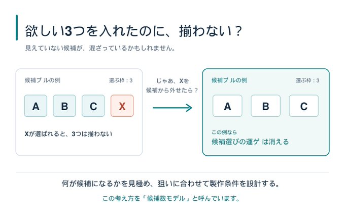

---
layout: default
title: ルーンファクトリー装備継承研究
description: ルンファク4SP・5の装備継承、アレンジ、継承確率を実機検証と統計分析から解説する研究サイトです。
lang: ja
---

# ルーンファクトリー装備継承研究

ルーンファクトリー4スペシャル（RF4SP）・
ルーンファクトリー5（RF5）の装備継承について、
実機観測と統計・数学モデルから研究しています。

## 装備継承の仕組み

- 候補数モデル
- オートアレンジ
- 装備本体候補化
- 内部アレンジ参照
- 継承成功確率
- メッシライト鉱石による継承

## 候補数モデル

## 研究資料

[日本語研究資料（PDF）](pdf/)

[GitHub研究アーカイブ](https://github.com/j13343sh/Rune-Factory-Inheritance-Research)

## 今後の研究

ルーンファクトリー6についても、
装備システムに関する知見が得られ次第、
研究成果を蓄積する予定です。
