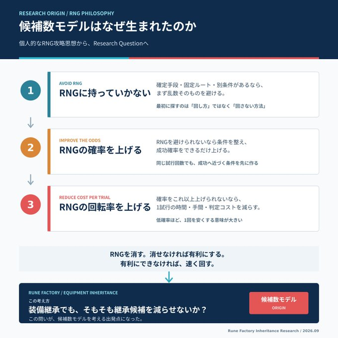

---
layout: default
title: ルーンファクトリー4SP・5 装備継承研究｜アレンジ・継承確率
description: ルンファク4SP・5の装備継承、オートアレンジ、候補数モデル、継承成功確率を実機観測と統計分析から解説。RF5の4,000回検証と日本語研究資料を公開。
lang: ja
---

# ルーンファクトリー装備継承研究

**RF4SP・RF5｜実機観測・統計分析・数学モデル**

ルーンファクトリー4スペシャル（ルンファク4SP／RF4SP）・ルーンファクトリー5（ルンファク5／RF5）の装備継承・装備アレンジの仕組みや継承確率を、実機観測と統計・数学モデルから調べた研究サイトです。

狙った性能を継承するには、どの素材を投入し、何が継承候補になるかを考える必要があります。

本サイトでは、装備製作の試行錯誤を減らすための考え方と、その根拠となる研究資料を紹介します。

---

## 目次

- [候補数モデル](#候補数モデル)
- [4,000回の実機検証](#4000回の実機検証)
- [装備継承の研究項目](#装備継承の研究項目)
- [研究の出発点](#研究の出発点)
- [日本語研究資料](#日本語研究資料)
- [好感度上げ・攻略研究](#好感度上げ攻略研究)
- [研究方針と今後の展望](#研究方針と今後の展望)

---

## 候補数モデル

### なぜ装備継承は狙い通りにならないのか？

欲しい性能が継承されるかどうかは、投入した素材の数だけでは説明できません。

「何が候補になるか」を見極め、狙う結果に合わせて製作条件を設計する。

この考え方を**候補数モデル（Candidate Count Model）**として整理しています。

### 椅子取りゲームで考える装備継承

装備継承を椅子取りゲームに例えると、次のように考えることができます。

- 椅子：継承枠
- 参加者：継承候補
- 座ってほしい参加者：狙った継承候補
- 座ってほしくない参加者：不要な継承候補

重要なのは、単純に素材を増やすことではなく、継承候補の構成を考えることです。

ただし、この比喩は装備継承を理解するためのものであり、ゲーム内部の抽選方式を確定するものではありません。

### 詳細資料

- [候補数モデルの研究記事（英語）](https://github.com/j13343sh/Rune-Factory-Inheritance-Research/blob/main/articles/Candidate-Count-Model.md)
- [数式・一般化モデル（日本語PDF）](pdf/07_数式・一般化モデル.pdf)

---

## 4,000回の実機検証

ルーンファクトリー5では、3積みから6積みまで各条件1,000回、合計4,000回の継承試行を行いました。

| 実験条件 | 試行数 | 成功回数 | 観測成功率 |
|:---|---:|---:|---:|
| 3積み | 1,000 | 250 | 25.0% |
| 4積み | 1,000 | 387 | 38.7% |
| 5積み | 1,000 | 519 | 51.9% |
| 6積み | 1,000 | 571 | 57.1% |
| 合計 | 4,000 | — | — |

### 観測成功率の比較

  

    <strong>3積み：25.0%</strong>
    

      

    

  

  

    <strong>4積み：38.7%</strong>
    

      

    

  

  

    <strong>5積み：51.9%</strong>
    

      

    

  

  

    <strong>6積み：57.1%</strong>
    

      

    

  

### 検証結果から分かること

今回の実験条件では、積み数の増加に伴って成功率が上昇しました。

一方、5積みから6積みへの改善幅は5.2ポイントにとどまりました。

| 条件の変更 | 成功率の改善幅 |
|:---|---:|
| 3積み → 4積み | +13.7ポイント |
| 4積み → 5積み | +13.2ポイント |
| 5積み → 6積み | +5.2ポイント |

これらは特定の実験条件における観測結果です。

すべての装備製作に適用できる普遍的な成功確率ではなく、内部抽選式や候補数の上限を確定した結果でもありません。

### 詳細資料

- [抽選処理解析（日本語PDF）](pdf/06_抽選処理解析.pdf)
- [数式・一般化モデル（日本語PDF）](pdf/07_数式・一般化モデル.pdf)
- [成功確率の研究記事（英語）](https://github.com/j13343sh/Rune-Factory-Inheritance-Research/blob/main/articles/Success-Probability.md)

---

## 装備継承の研究項目

### 1. オートアレンジ

装備製作時に、レシピの必須素材が継承候補になる場合について研究しています。

狙った素材だけでなく、意図していない素材が候補となることで、継承結果に影響する場合があります。

- [オートアレンジ詳細（日本語PDF）](pdf/03_オートアレンジ詳細.pdf)
- [研究記事（英語）](https://github.com/j13343sh/Rune-Factory-Inheritance-Research/blob/main/articles/Auto-Arrange.md)

### 2. 装備本体候補化

継承元の装備本体が候補として現れる挙動を扱います。

候補プールへ至る内部処理については、現段階では確定していません。

- [日本語PDF（旧名称：自己混入解析）](pdf/04_自己混入解析.pdf)
- [研究記事（英語）](https://github.com/j13343sh/Rune-Factory-Inheritance-Research/blob/main/articles/Self-Contamination.md)

### 3. 内部アレンジ参照

装備内部のアレンジ素材が参照される挙動について研究しています。

同カテゴリの装備を複数投入した条件では、先に投入した装備と結果の対応が反復検証で観測されています。

この条件付きの観測規則を、第一同カテゴリ内部アレンジ参照として整理しています。

「第一」は投入順と結果の対応を指すものであり、内部の走査順や再帰アルゴリズムを証明するものではありません。

- [日本語PDF（旧名称：再帰処理解析）](pdf/05_再帰処理解析.pdf)
- [研究記事（英語）](https://github.com/j13343sh/Rune-Factory-Inheritance-Research/blob/main/articles/Recursive-Processing.md)

### 4. 継承成功確率

継承候補の構成、組合せ空間、成功確率の関係を数学的に検討しています。

実機観測と数学モデルを比較し、観測結果をどこまで説明できるかを研究しています。

- [抽選処理解析（日本語PDF）](pdf/06_抽選処理解析.pdf)
- [数式・一般化モデル（日本語PDF）](pdf/07_数式・一般化モデル.pdf)
- [研究記事（英語）](https://github.com/j13343sh/Rune-Factory-Inheritance-Research/blob/main/articles/Success-Probability.md)

### 5. メッシライト鉱石による継承

メッシライト鉱石を用いた装備継承の観測を通じて、候補数と組合せによる説明を検討しています。

- [メッシライト継承解析（日本語PDF）](pdf/08_メッシライト継承解析.pdf)
- [研究記事（英語）](https://github.com/j13343sh/Rune-Factory-Inheritance-Research/blob/main/articles/Messhilite-Inheritance.md)

### 6. 高難度継承と実用的な装備製作

狙った性能と外見を両立する装備製作や、高難度の継承に関する研究をまとめています。

- [高難度継承と実運用（日本語PDF）](pdf/09_高難度継承と実運用.pdf)
- [ロールプレイ装備研究（日本語PDF）](pdf/10_ロールプレイ装備研究.pdf)

---

## 研究の出発点

本研究は、装備の性能を犠牲にせず、好みの外見を持つロールプレイ装備を、現実的な試行回数で製作したいという疑問から始まりました。

なぜ、ある装備製作では簡単に継承が成功する一方、別の装備製作では何度試しても成功しないのか。

単純な試行錯誤だけでなく、その違いを説明するために実機観測と数学的な分析を進めてきました。

---

## 日本語研究資料

初めて読む方は、サマリーと基本仕様整理からご覧ください。

### PDF研究資料一覧

| 資料 | 内容 |
|:---|:---|
| [00 継承仕様整理](pdf/00_README_継承仕様整理.pdf) | 研究資料の案内 |
| [00 サマリー](pdf/00_サマリー.pdf) | 研究全体の概要 |
| [01 用語定義](pdf/01_用語定義.pdf) | 研究用語の整理 |
| [02 基本仕様整理](pdf/02_基本仕様整理.pdf) | 装備継承の基本 |
| [03 オートアレンジ詳細](pdf/03_オートアレンジ詳細.pdf) | オートアレンジの研究 |
| [04 自己混入解析](pdf/04_自己混入解析.pdf) | 装備本体候補化・旧名称 |
| [05 再帰処理解析](pdf/05_再帰処理解析.pdf) | 内部アレンジ参照・旧名称 |
| [06 抽選処理解析](pdf/06_抽選処理解析.pdf) | 抽選の観測と分析 |
| [07 数式・一般化モデル](pdf/07_数式・一般化モデル.pdf) | 数学モデル |
| [08 メッシライト継承解析](pdf/08_メッシライト継承解析.pdf) | メッシライト鉱石の研究 |
| [09 高難度継承と実運用](pdf/09_高難度継承と実運用.pdf) | 実用的な装備製作 |
| [10 ロールプレイ装備研究](pdf/10_ロールプレイ装備研究.pdf) | 外見と性能の両立 |
| [11 未解決問題・今後の検証課題](pdf/11_未解決問題・今後の検証課題.pdf) | 未解決事項 |
| [12 補遺](pdf/12_補遺.pdf) | 補足資料 |
| [99 付録 AI比較ログ](pdf/99_付録_AI比較ログ.pdf) | AIによる比較・検討記録 |

※一部のPDFファイル名には、研究過程で使用していた旧名称が残っています。

### 公開アーカイブ

- [日本語PDF全資料](https://github.com/j13343sh/Rune-Factory-Inheritance-Research/tree/main/pdf)
- [公開Google Drive（PDF・観測記録など）](https://drive.google.com/drive/u/0/folders/1y9JR9AFVTS0ytAcWwDjW5m9K1c4tW2cB?ths=true)
- [実験データ・CSV](https://github.com/j13343sh/Rune-Factory-Inheritance-Research/tree/main/csv)
- [研究記録](https://github.com/j13343sh/Rune-Factory-Inheritance-Research/tree/main/research)
- [英語研究記事一覧](https://github.com/j13343sh/Rune-Factory-Inheritance-Research/tree/main/articles)

---

## 好感度上げ・攻略研究

装備継承以外にも、ルーンファクトリー4SP・5の好感度上げ、日課の効率化、実際のプレイを通じた攻略研究を公開しています。

### 好感度上げ

- [効率的な好感度上げ戦略（英語）](https://github.com/j13343sh/Rune-Factory-Inheritance-Research/blob/main/articles/Efficient-Friendship-Farming-Strategy.md)
- [RF5 日課による好感度上げ（英語）](https://github.com/j13343sh/Rune-Factory-Inheritance-Research/blob/main/articles/RF5-Daily-Friendship-Farming-Guide.md)
- [RF4SP 日課による好感度上げ（英語）](https://github.com/j13343sh/Rune-Factory-Inheritance-Research/blob/main/articles/RF4SP-Daily-Friendship-Farming-Guide.md)
- [3種類のプレゼントに関する研究（英語）](https://github.com/j13343sh/Rune-Factory-Inheritance-Research/blob/main/articles/Triple-Gift-Mechanics.md)

### 攻略・プレイ事例

- [RF5 春のストーリークリア・引継ぎプレイ](https://github.com/j13343sh/Rune-Factory-Inheritance-Research/blob/main/case-studies/RF5-Spring-Story-Clear.md)
- [RF5 リグバースの迷宮・早期攻略](https://github.com/j13343sh/Rune-Factory-Inheritance-Research/blob/main/case-studies/RF5-Rigbarth-Maze-Early-Challenge.md)
- [RF5 春4～5日の銅入手ルート](https://github.com/j13343sh/Rune-Factory-Inheritance-Research/blob/main/case-studies/RF5-Spring-4-5-Copper-Route.md)
- [RF5 宝箱の出現パターン](https://github.com/j13343sh/Rune-Factory-Inheritance-Research/blob/main/case-studies/RF5-Treasure-Chest-Pattern.md)

---

## 研究方針と今後の展望

### 研究方針

本サイトの公開研究は、ゲーム内での反復検証と統計分析に基づきます。

研究内容は以下を区別して整理しています。

- 実機検証によって観測された事実
- 観測結果を説明する数学モデル
- 現段階では確定していない仮説
- 今後の追加検証が必要な事項

ゲーム内部のプログラムや抽選アルゴリズムを確定したと主張するものではありません。

新しい観測結果によって、既存のモデルや解釈を修正する場合があります。

### ルーンファクトリー6（RF6）

将来的には、ルーンファクトリー6（ルンファク6／RF6）についても、装備継承に関連する検証可能な仕組みが確認できれば、研究対象として追加する予定です。

---

## 関連リンク

- [GitHub研究アーカイブ（日英併記）](https://github.com/j13343sh/Rune-Factory-Inheritance-Research)
- [研究全体の道筋・ロードマップ](https://github.com/j13343sh/Rune-Factory-Inheritance-Research/blob/main/ROADMAP.md)
- [研究方法論](https://github.com/j13343sh/Rune-Factory-Inheritance-Research/tree/main/research-methodology)
- [公開Google Drive](https://drive.google.com/drive/u/0/folders/1y9JR9AFVTS0ytAcWwDjW5m9K1c4tW2cB?ths=true)

---

## ライセンス

本研究アーカイブは、CC BY-NC 4.0ライセンスのもとで公開しています。

[ライセンスの詳細](https://github.com/j13343sh/Rune-Factory-Inheritance-Research/blob/main/LICENSE.md)

本サイトは個人による非公式の研究サイトです。
